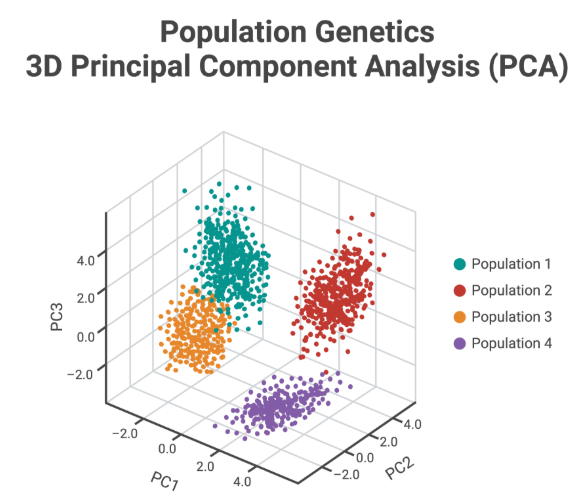
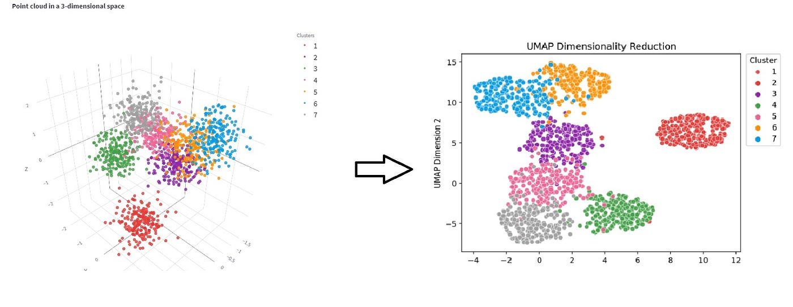
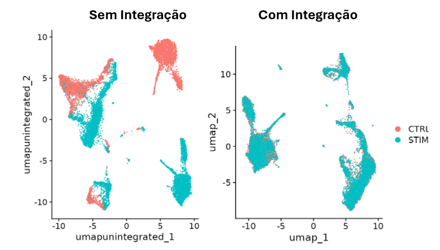

{fig-align="center"}

## Single Cell - Psiquiatria

Sejam bem-vindos ao curso de análise de sequenciamento de núcleo único (snRNA-Seq) voltado à genética psiquiátrica. Ao longo deste script, serão abordados temas e métodos relacionados à estrutura dos arquivos, ao controle de qualidade, à normalização, à clusterização e às análises estatísticas.

Nessa aula utilizaremos um artigo que realizou snRNA-Seq no córtex pré-frontal de homens e mulheres controles e com depressão maior:

Maitra, M., Mitsuhashi, H., Rahimian, R. *et al.* Cell type specific transcriptomic differences in depression show similar patterns between males and females but implicate distinct cell types and genes. *Nat Commun* **14**, 2912 (2023). https://doi.org/10.1038/s41467-023-38530-5

# 1º - Biblioteca

A realização das análises de scRNA-seq é complexa, envolvendo etapas de machine learning e processos estatísticos robustos. Por isso, a utilização de pacotes e ferramentas apropriados é necessária.

Caso seja a primeira vez, instale os pacotes (só precisa fazer uma vez):

```{r Instalacao, eval=FALSE}
install.packages(c("Seurat", "tidyverse", "data.table", "Matrix", "openxlsx", "cluster", "BiocManager"))
BiocManager::install(c("GEOquery", "DESeq2", "clusterProfiler", "org.Hs.eg.db"))
```

```{r Library}
options(future.globals.maxSize = 8 * 1024^3) #Ajusta o limite de memória
options(timeout = 3600) #Dá mais tempo para baixar arquivos grandes
set.seed(1234) #Garante que os resultados sejam sempre os mesmos

library(Seurat) #Utilizado para manipular objetos de scRNA-Seq
library(tidyverse) #Manipulação e gerenciamento das tabelas
library(data.table) #Leitura rápida de tabelas grandes
library(Matrix) #Ferramenta necessária para manipular matrizes
library(openxlsx) #Ferramenta necessária para manipular tabelas Excel
library(cluster) #Pacote para métricas de clusterização
```

# 2º - Abrindo os arquivos

Os dados de single-cell RNA-seq podem ser obtidos em diferentes formatos, como matrizes de contagem convencionais (`.txt`, `.mtx`, `.csv` e `.h5`). Em geral, esses arquivos são utilizados quando se trabalha com dados mais brutos, provenientes diretamente do sequenciamento realizado pelo grupo de pesquisa ou disponibilizados em repositórios públicos. Também é possível encontrar objetos que, além da matriz de expressão gênica, já incluem outras informações associadas às células e aos indivíduos, como arquivos `.rds` e `.h5ad`.

Cada um desses formatos requer funções ou comandos específicos para importação. Portanto, para fins didáticos, começaremos com um conjunto de arquivos não processados, que contém os nomes das células, os nomes dos genes, a matriz de contagem (`.mtx`) e uma tabela com informações adicionais fornecidas pelos autores (`meta.tsv`).

## Onde estão os dados?

Todo artigo informa onde os dados estão disponíveis (seção *Data availability*). Neste estudo, usaremos:

- **GEO (GSE213982):** a matriz de contagens brutas → https://www.ncbi.nlm.nih.gov/geo/query/acc.cgi?acc=GSE213982
- **UCSC Cell Browser:** a tabela com as informações de cada célula (`meta.tsv`) → https://dlpfc-mdd.cells.ucsc.edu

> **Atalho para a aula:** a matriz completa é grande (\~1,3 GB) e precisa de um computador com bastante memória (≥ 32 GB de RAM). Por isso, deixei pronto o arquivo `Data.rds` no GitHub do curso. Baixe-o, coloque na pasta `dados/` e pule direto para o chunk **Seurat Object**.

Caso queira refazer tudo do zero, rode os chunks abaixo (eles não rodam sozinhos ao renderizar o documento):

```{r Download, eval=FALSE}
#Criar as pastas onde os arquivos serão salvos
dir.create("dados/brutos", recursive = TRUE, showWarnings = FALSE)

#Baixar a matriz de contagens do GEO
library(GEOquery)
getGEOSuppFiles("GSE213982", baseDir = "dados/brutos", makeDirectory = FALSE,
                filter_regex = "combined_counts_matrix")

#Baixar a tabela de informações das células (UCSC Cell Browser)
download.file("https://cells.ucsc.edu/dlpfc-mdd/meta.tsv",
              destfile = "dados/brutos/meta.tsv", mode = "wb")
```

A primeira etapa desse processo será a abertura do arquivo de metadados disponibilizado no estudo. Esse arquivo contém informações de cada célula, como seu barcode, o batch de origem, o grupo experimental e o sexo. O nome de cada célula também indica de qual pessoa ela veio (ex.: `F1.AAACCCACACCTCTGT-1.Mic.Mic1` → amostra **F1**). Vamos guardar essa informação em uma coluna chamada `Sample`, pois ela será importante mais à frente.

```{r Metadata, eval=FALSE}
meta = read.table("dados/brutos/meta.tsv", header = TRUE, sep = "\t", as.is = TRUE, row.names = 1)

#Criar a coluna com a amostra (pessoa) de origem de cada célula
meta$Sample = sub("\\..*$", "", rownames(meta))

print(head(meta)) #Informações de cada célula, origem e grupo experimental
```

A próxima etapa consiste em abrir a matriz de contagens e, a partir dela, criar um objeto Seurat. De forma simplificada, o objeto Seurat funciona como um contêiner que armazena, em um único lugar, a matriz de expressão gênica, os metadados das células, os dados normalizados e outras informações geradas ao longo da análise.

Para que a aula rode em um computador comum, vamos utilizar apenas o **Batch 6M** (8 homens: 3 com depressão e 5 controles).

```{r Data, eval=FALSE}
#Abrir os arquivos e gerar a matriz de expressão (Genes x Células)
mat = readMM("dados/brutos/GSE213982_combined_counts_matrix.mtx.gz")
cells = fread("dados/brutos/GSE213982_combined_counts_matrix_cells_columns.csv.gz")
genes = fread("dados/brutos/GSE213982_combined_counts_matrix_genes_rows.csv.gz")
rownames(mat) = as.character(genes[[1]])
colnames(mat) = as.character(cells[[1]])

#Conferir se as células da tabela de metadados estão todas na matriz (deve retornar TRUE)
all(rownames(meta) %in% colnames(mat))

#Pegar apenas o Batch 6M
cells_6M = rownames(meta)[meta$Batch == "6M"]
mat = as(mat[, cells_6M], "CsparseMatrix")

#Criar objeto Seurat
Data = CreateSeuratObject(mat, meta.data = meta[cells_6M, ])
saveRDS(Data, "dados/Data.rds") #Salvar objeto
```

```{r Seurat Object}
#Abrir o objeto Seurat
Data = readRDS("dados/Data.rds")

#Criar a coluna "Sample", caso ainda não exista
Data$Sample = sub("\\..*$", "", colnames(Data))

#Visualizar objeto
print(Data)
print(head(Data@meta.data))

#Quantas células temos de cada pessoa?
table(Data$Sample, Data$Condition)
```

Repare que temos milhares de células, mas apenas 8 pessoas. Guarde essa informação: ela será importante na análise diferencial.

# 3º - Controle de Qualidade

Uma vez abertos e convertidos para o formato Seurat, os dados devem passar por uma etapa fundamental de controle de qualidade (QC). Nessa etapa, diferentes critérios podem ser aplicados, entre eles a remoção de RNA contaminante, a definição de limiares para a proporção de transcritos mitocondriais e/ou ribossomais, a identificação de doublets e a detecção de outliers com base no desvio absoluto mediano (MAD) por amostra. A aplicação desses critérios, bem como suas diferentes estratégias de implementação, é discutida em mais detalhes por Heumos et al. 2023, Amezquita et al. 2020 e Hao et al. 2024.

Para fins didáticos e por se tratar de critérios amplamente utilizados, adotaremos como medidas de QC a definição de limiares para a proporção de transcritos mitocondriais e ribossomais (\<5%) e a exclusão de células com valor de MAD superior a 5.

```{r QC-Percent MT/Ribo}
print(paste("Número de Células pré QC: ", ncol(Data)))

#Adicionar porcentagem mitocondrial e ribossomal
Data[["percent.mt"]] = PercentageFeatureSet(Data, pattern = "^MT-")
Data[["percent.ribo"]] = PercentageFeatureSet(Data, pattern = "^RP[SL]")

#Gráfico
VlnPlot(Data, c("percent.mt", "percent.ribo"), pt.size = 0) # Nesse caso, o valor exibido é 0 em percent.mt, pois os genes mitocondriais foram previamente removidos pelo autor do estudo. (OBS: Evitem remover os genes mitocondriais, eles são importantes!)

#Pegar apenas as células com porcentagem mitocondrial e ribossomal < 5%
Data = subset(Data, subset = percent.mt < 5 & percent.ribo < 5)
```

```{r QC-MAD}
#Transformar a quantidade de expressão e de tipos de RNA em Log
Data$log1p_counts = log1p(Data$nCount_RNA)
Data$log1p_features = log1p(Data$nFeature_RNA)

#Função MAD
is_outlier = function(x, nmads = 5) {
  med = median(x, na.rm = TRUE)
  mad_val = mad(x, center = med, constant = 1, na.rm = TRUE)
  (x < (med - nmads * mad_val)) | (x > (med + nmads * mad_val))}

#Identificar Outliers (MAD > 5) em cada amostra
QC = Data@meta.data %>%
  tibble::rownames_to_column("cell_id") %>%
  group_by(Sample) %>%
  mutate(
    outlier_counts = is_outlier(log1p_counts, nmads = 5),
    outlier_features = is_outlier(log1p_features, nmads = 5),
    outlier_MAD = outlier_counts | outlier_features) %>%
  ungroup()

cells_keep = QC %>%
  filter(!outlier_MAD) %>%
  pull(cell_id)

#Remover Outliers
Data = subset(Data, cells = cells_keep)
print(paste("Número de Células pós QC: ", ncol(Data)))
```

# 4º - Normalização e Análise de componentes

Após a realização do controle de qualidade, a próxima etapa consiste na normalização da expressão gênica de cada amostra. Em seguida, são identificados os genes mais variáveis entre as células, que servirão de base para a clusterização e para a identificação de grupos celulares com perfis de expressão gênica semelhantes.

```{r Standard Analysis}
#Separar as contagens por amostra
Data[["RNA"]] = split(Data[["RNA"]], f = Data$Sample)

#Normalizar as contagens (Log)
Data = NormalizeData(Data)

#Encontrar os principais genes variáveis (Default = 2000)
Data = FindVariableFeatures(Data)

#Escalonar os dados (Z-Score)
Data = ScaleData(Data)

#Executar a análise de componentes principais (PCA)
Data = RunPCA(Data)
```

Após a identificação dos 50 principais componentes principais (PCs), obtemos um objeto multidimensional composto por 50 dimensões. Cada uma dessas dimensões representa combinações de genes que contribuem para a separação entre diferentes grupos celulares. A título de exemplo, a imagem abaixo ilustra um gráfico com apenas três dimensões. A partir dessa representação, é possível visualizar como as células se distribuem no espaço reduzido e identificar agrupamentos com perfis de expressão gênica semelhantes, que frequentemente correspondem a diferentes tipos celulares.

{fig-align="center" width="519"}

Posteriormente à identificação das dimensões principais e das relações de vizinhança entre as células, é possível reduzir a complexidade dos dados, que originalmente estão representados em dezenas de dimensões, geralmente entre 30 e 100, para um espaço bidimensional por meio da técnica Uniform Manifold Approximation and Projection (UMAP). Essa abordagem permite projetar os dados em duas dimensões, facilitando a visualização da distribuição celular e a identificação de grupos de células ou núcleos com perfis de expressão gênica semelhantes, conforme ilustrado na imagem abaixo.

{fig-align="center"}

```{r UMAP}
#Identificar quais componentes principais explicam a heterogeneidade dos dados
ElbowPlot(Data, ndims = 50) #O gráfico sugere que, por volta do PC 20, a curva atinge um platô
#Portanto, nesse caso utilizarei os componentes do 1 ao 20, para me auxiliar na identificação de células vizinhas

#Identificar células próximas/vizinhas
Data = FindNeighbors(Data, dims = 1:20, reduction = "pca")

#Identificar grupos de células vizinhas próximas (Clusters)
Data = FindClusters(Data, resolution = 0.5, cluster.name = "unintegrated_clusters")

#Reduzir a dimensionalidade, de 20 para 2
Data = RunUMAP(Data, dims = 1:20, reduction = "pca", reduction.name = "umap.unintegrated")

#Gráfico UMAP, sendo as células categorizadas por amostra
DimPlot(Data, reduction = "umap.unintegrated", group.by = "Sample")
```

# 5º - Integração

Embora os dados sejam normalizados, diferenças entre doadores e outras variáveis confundidoras, como sexo, idade, técnica e profundidade de sequenciamento, ainda podem influenciar a segregação celular e o UMAP. Como ilustrado na figura (exemplo da vinheta de integração do Seurat), à esquerda observa-se um forte agrupamento associado à origem da amostra, enquanto, após a correção desse efeito, à direita, as células passam a se organizar predominantemente de acordo com seus perfis de expressão gênica.

{fig-align="center" width="568"}

Existem diversas abordagens para correção de efeito de lote em dados de célula única. Entre elas, destaca-se a integração baseada em análise de correlação canônica (CCA), que projeta os conjuntos de dados em um espaço compartilhado e permite identificar âncoras entre células com perfis de expressão gênica semelhantes provenientes de diferentes indivíduos ou condições. Essa estratégia é eficaz para alinhar tipos celulares correspondentes entre amostras. Contudo, em conjuntos de dados muito extensos, esse método pode demandar maior tempo de execução e maior uso de memória, o que motivou o desenvolvimento e a adoção de alternativas mais escaláveis, como a análise de componentes principais recíproca (RPCA), na qual cada conjunto de dados é projetado no espaço de componentes principais do outro para a identificação de âncoras de integração.

Aqui, corrigimos as diferenças entre as **amostras** (pessoas), que foram separadas anteriormente pelo comando `split`.

```{r Integration}
#Integrar o objeto, corrigindo a variável indicada anteriormente pelo comando: Data[["RNA"]] = split(Data[["RNA"]], f = Data$Sample)
Data = IntegrateLayers(object = Data, method = RPCAIntegration,
                       orig.reduction = "pca",
                       new.reduction = "integrated.rpca",
                       verbose = FALSE)

#Juntar a expressão gênica, para posteriormente realizar a análise de expressão diferencial entre as condições
Data[["RNA"]] = JoinLayers(Data[["RNA"]])

#Identificar células vizinhas
Data = FindNeighbors(Data, reduction = "integrated.rpca", dims = 1:20)

#Identificar agrupamentos celulares
Data = FindClusters(Data, resolution = 0.5)

#Reduzir as dimensões (De 20, para 2)
Data = RunUMAP(Data, dims = 1:20, reduction = "integrated.rpca")

#Gerar Gráfico
DimPlot(Data, reduction = "umap", shuffle = TRUE, group.by = c("Sample", "Condition"))
```

Vale ressaltar que, para o parâmetro de resolução, utilizamos o valor 0.5, correspondente ao padrão frequentemente empregado em tutoriais do Seurat. Esse parâmetro influencia a granularidade da clusterização, de modo que valores mais altos tendem a gerar um maior número de clusters, enquanto valores mais baixos resultam em agrupamentos mais amplos. Entretanto, a escolha da resolução ideal não deve se basear apenas no valor padrão, uma vez que diferentes métodos estatísticos podem auxiliar na definição mais adequada do número de clusters. Entre eles, destacam-se a análise de silhouette, o within-cluster dispersion e o índice de Banfield-Raftery, sendo os dois últimos apontados como métricas mais consistentes do que a silhouette em avaliações recentes. Ainda assim, a análise de silhouette permanece amplamente utilizada, principalmente por sua simplicidade de interpretação e facilidade de implementação (Sciaraffa et al., 2025).

```{r Silhouette}
Data = FindClusters(Data, resolution = 0.3) #Resolução utilizada no restante da aula

distance_matrix = dist(Embeddings(Data[['integrated.rpca']])[, 1:20]) #Obter valores de dimensionalidade (mesmo espaço usado nos clusters)
clusters = Data@meta.data$seurat_clusters #Obter os agrupamentos celulares
silhouette = silhouette(as.numeric(clusters), dist = distance_matrix) #Calcular a aproximação entre as células do cluster
Data@meta.data$silhouette_score = silhouette[,3] #Colocar essas informações no meta.data
mean_silhouette_score = mean(Data@meta.data$silhouette_score) #Calcular o valor médio

#Gráfico
Data@meta.data %>%
  mutate(barcode = rownames(.)) %>%
  arrange(seurat_clusters,-silhouette_score) %>%
  mutate(barcode = factor(barcode, levels = barcode)) %>%
  ggplot() +
  geom_col(aes(barcode, silhouette_score, fill = seurat_clusters), show.legend = FALSE) +
  geom_hline(yintercept = mean_silhouette_score, color = 'red', linetype = 'dashed') +
  scale_x_discrete(name = 'Cells') +
  scale_y_continuous(name = 'Silhouette score') +
  theme_bw() +
  theme(
    axis.title.x = element_blank(),
    axis.text.x = element_blank(),
    axis.ticks.x = element_blank(),
    panel.grid.major = element_blank(),
    panel.grid.minor = element_blank())
```

# 6º - Classificação

Como resultado das etapas anteriores, obtemos um UMAP com diferentes agrupamentos celulares. Entretanto, para compreender melhor o impacto da condição experimental em cada tipo celular, é necessário, como primeira etapa, identificar e classificar os clusters obtidos. Essa anotação pode ser realizada com base na expressão de genes marcadores característicos de cada população celular, permitindo atribuir identidade biológica aos agrupamentos observados. Como alternativa, também é possível utilizar ferramentas automatizadas para anotação celular, como ScType e SingleR. No entanto, o desempenho dessas abordagens pode variar de acordo com a qualidade do conjunto de dados, a referência utilizada e o nível de granularidade desejado, o que pode limitar a identificação de subpopulações celulares mais específicas.

```{r Clusters}
#Clusters obtidos até o momento
DimPlot(Data, reduction = "umap", shuffle = TRUE,
        group.by = c("seurat_clusters"), label = TRUE)
```

Com base nessa proposta, utilizaremos nesta aula a abordagem de classificação manual. Para isso, empregaremos um conjunto de genes previamente descritos na literatura como marcadores específicos de determinados tipos celulares, a fim de atribuir identidade aos clusters obtidos. No nosso caso, utilizaremos os genes mencionados pelos próprios autores do estudo como referência para essa anotação.

```{r Anotacao}
#Dotplot com os marcadores utilizados pelos autores para classificar as células
DotPlot(Data, features = c("SNAP25","SLC17A7","GAD1","ALDH1L1","PDGFRA","PLP1","CLDN5","CX3CR1")) + RotatedAxis()
# SNAP25 = neurônios | SLC17A7 = excitatórios | GAD1 = inibitórios | ALDH1L1 = astrócitos
# PDGFRA = OPCs | PLP1 = oligodendrócitos | CLDN5 = endotélio | CX3CR1 = micróglia

#Novas identidades dos clusters (confira no DotPlot: o número dos clusters pode mudar de um computador para outro)
New_Idents = c(
  "0" = "Ext1",
  "1" = "Ext2",
  "2" = "Ext3",
  "3" = "Inh1",
  "4" = "Inh2",
  "5" = "Astrocyte",
  "6" = "Ext4",
  "7" = "Ext5",
  "8" = "Inh3",
  "9" = "Ext6",
  "10" = "Oligo",
  "11" = "OPCs",
  "12" = "Inh4",
  "13" = "Ext7",
  "14" = "Ext8",
  "15" = "Inh5",
  "16" = "Ext9",
  "17" = "Ext10",
  "18" = "Ext11")

#Renomear os clusters
Data = RenameIdents(Data, New_Idents)

#Adicionar essa nova informação no Metadata (em uma coluna nova, para não apagar a coluna "Cluster" dos autores)
Data$Anotacao = Idents(Data)
saveRDS(Data, "dados/Data_Final.rds") #Salvar objeto Final

#Gerar Plot UMAP
DimPlot(Data, group.by = "Anotacao", label = TRUE)

#Comparar a nossa classificação com a dos autores
table(Data$Anotacao, Data$Broad)
```

# 7º - Análise diferencial

Uma das etapas mais importantes na análise de scRNA-seq é a identificação de genes diferencialmente expressos (DEGs) entre condições experimentais dentro de cada tipo celular. Para isso, três abordagens são amplamente utilizadas: o teste de Wilcoxon, o Model-based Analysis of Single-cell Transcriptomics (MAST) e a estratégia de pseudo-bulk.

O teste de Wilcoxon é o método padrão implementado no Seurat. Trata-se de um teste não paramétrico que compara a expressão gênica entre dois grupos de células, como controle e tratamento. Embora seja simples, rápido e amplamente utilizado, esse método considera as células como observações independentes, o que pode introduzir viés quando há predominância de células provenientes do mesmo indivíduo.

O MAST, por sua vez, foi desenvolvido especificamente para dados de célula única. Em geral, apresenta desempenho superior ao Wilcoxon, principalmente por permitir a inclusão de covariáveis no modelo estatístico, aumentando a robustez da análise.

Já a abordagem de pseudo-bulk consiste em agregar as contagens das células de um mesmo tipo celular por amostra, gerando perfis que podem ser analisados por métodos clássicos como o DESeq2. Atualmente, essa estratégia é considerada uma das mais robustas para comparações entre condições, pois reduz o problema da pseudorreplicação.

Para facilitar a compreensão, utilizaremos nesta aula o teste de Wilcoxon, por ser o mais simples e o padrão do Seurat. Ao final, mostramos como fazer a mesma comparação com o pseudo-bulk. Nesta etapa, identificaremos os genes diferencialmente regulados na depressão nos neurônios SST e PVALB do córtex.

Para separar esses neurônios, usaremos a classificação feita pelos autores (coluna `Cluster`), que já identifica as populações SST e PVALB.

```{r DEGs}
#Identificação de populações inibitórias SST e PVALB
Idents(Data) = "Cluster"
DotPlot(Data, features = c("GAD1", "PVALB", "SST"),
        idents = c("InN2_SST", "InN5_SST", "InN1_PV", "InN9_PV"))

#Isolar neurônios
SST = subset(Data, subset = Cluster %in% c("InN2_SST", "InN5_SST"))
Pvalb = subset(Data, subset = Cluster %in% c("InN1_PV", "InN9_PV"))

#Análise estatística

#SST
#Análise estatística, dizendo quais são os grupos comparados, o threshold de FoldChange, e a quantidade (%) mínima de células expressando o gene para que seja considerado significativo
Markers_SST = FindMarkers(SST, group.by = "Condition", ident.1 = "Case", ident.2 = "Control",
                          assay = "RNA", logfc.threshold = 0.2, min.pct = 0.2)
Markers_SST = subset(Markers_SST, subset = p_val_adj < 0.05) #Pegar apenas os significativos
Markers_SST = rownames_to_column(Markers_SST, "Gene") #Criar uma coluna para os rownames
Markers_SST$Cluster = "SST" #Adicionar uma coluna especificando que essa análise foi para os SST
write.xlsx(Markers_SST, "Marcadores_SST_Depressao.xlsx") #Salvar os DEGs
print(head(Markers_SST))

#PVALB
Markers_Pvalb = FindMarkers(Pvalb, group.by = "Condition", ident.1 = "Case", ident.2 = "Control",
                            assay = "RNA", logfc.threshold = 0.2, min.pct = 0.2)
Markers_Pvalb = subset(Markers_Pvalb, subset = p_val_adj < 0.05) #Pegar apenas os significativos
Markers_Pvalb = rownames_to_column(Markers_Pvalb, "Gene") #Criar uma coluna para os rownames
Markers_Pvalb$Cluster = "PVALB" #Adicionar uma coluna especificando que essa análise foi para os PVALB
write.xlsx(Markers_Pvalb, "Marcadores_PVALB_Depressao.xlsx") #Salvar os DEGs
print(head(Markers_Pvalb))

#Gene > Gene sendo testado
#p_val > Valor de P
#avg_log2FC > Valor de alteração Log2 (Case em relação ao Control)
#pct.1 > Porcentagem de células do grupo Case que expressam o gene
#pct.2 > Porcentagem de células do grupo Control que expressam o gene
#p_val_adj > Valor de P ajustado (Bonferroni)
#Cluster > Cluster sendo testado
```

## Outra opção: pseudo-bulk

No pseudo-bulk, somamos as contagens de todas as células de cada pessoa. Assim, cada pessoa vira uma "amostra", e a comparação passa a ser entre 3 casos e 5 controles, e não entre milhares de células. Abaixo, seguimos o mesmo modelo da vinheta de expressão diferencial do Seurat.

```{r Pseudobulk}
#Somar as contagens por pessoa e condição
SST_pb = AggregateExpression(SST, assays = "RNA", return.seurat = TRUE, group.by = c("Condition", "Sample"))
Idents(SST_pb) = "Condition"

#Teste com DESeq2 (Case vs Control)
PB_SST = FindMarkers(SST_pb, ident.1 = "Case", ident.2 = "Control", test.use = "DESeq2")
PB_SST = subset(PB_SST, subset = p_val_adj < 0.05)
print(head(PB_SST))

#Comparar: quantos genes cada método encontrou nos neurônios SST?
c(Wilcoxon = nrow(Markers_SST), PseudoBulk = nrow(PB_SST))
```

Com apenas 8 pessoas, é esperado que o pseudo-bulk encontre bem menos genes que o Wilcoxon. Isso acontece porque o Wilcoxon trata cada célula como uma réplica independente, o que torna os valores de p artificialmente pequenos.

# 8º - Ontologia Genética

Após a identificação dos DEGs, uma etapa comum é a realização da análise de ontologia gênica, que busca identificar os principais processos biológicos e vias associados aos genes encontrados. Essa análise pode ser conduzida de diferentes formas, entre elas o Over-Representation Analysis (ORA) e o Gene Set Enrichment Analysis (GSEA). Neste exemplo, utilizaremos o ORA por meio do pacote clusterProfiler.

Como "universo" (background), usamos os genes expressos na população analisada, ou seja, os genes que tinham chance de aparecer como DEG.

```{r Ontology}
library(clusterProfiler)
library(org.Hs.eg.db)

#SST
## Background utilizado: genes detectados em pelo menos 10% dos neurônios SST
Background = rownames(SST)[rowMeans(LayerData(SST, layer = "counts") > 0) >= 0.1]
Background = bitr(Background, fromType="SYMBOL",
                  toType="ENTREZID", OrgDb="org.Hs.eg.db") #Converter o símbolo do gene em código

Markers_SST = read.xlsx("Marcadores_SST_Depressao.xlsx") #Abrir os DEGs
Markers_SST = bitr(Markers_SST$Gene, fromType="SYMBOL",
                   toType="ENTREZID", OrgDb="org.Hs.eg.db") #Converter o símbolo do gene em código

GO_SST = enrichGO(gene = Markers_SST$ENTREZID,
                  universe = Background$ENTREZID,
                  OrgDb         = org.Hs.eg.db,
                  ont           = "BP",
                  pAdjustMethod = "BH",
                  pvalueCutoff  = 0.05,
                  qvalueCutoff  = 0.05,
                  readable      = TRUE) #Rodar a análise de ontologia genética para processos biológicos (BP)
GO_SST = data.frame(GO_SST@result) %>% filter(p.adjust < 0.05)
write.xlsx(GO_SST,"GO_SST.xlsx")
print(head(GO_SST))

#PVALB
## Background utilizado: genes detectados em pelo menos 10% dos neurônios PVALB
Background = rownames(Pvalb)[rowMeans(LayerData(Pvalb, layer = "counts") > 0) >= 0.1]
Background = bitr(Background, fromType="SYMBOL",
                  toType="ENTREZID", OrgDb="org.Hs.eg.db") #Converter o símbolo do gene em código

Markers_PVALB = read.xlsx("Marcadores_PVALB_Depressao.xlsx") #Abrir os DEGs
Markers_PVALB = bitr(Markers_PVALB$Gene, fromType="SYMBOL",
                     toType="ENTREZID", OrgDb="org.Hs.eg.db") #Converter o símbolo do gene em código

GO_PVALB = enrichGO(gene = Markers_PVALB$ENTREZID,
                    universe = Background$ENTREZID,
                    OrgDb         = org.Hs.eg.db,
                    ont           = "BP",
                    pAdjustMethod = "BH",
                    pvalueCutoff  = 0.05,
                    qvalueCutoff  = 0.05,
                    readable      = TRUE) #Rodar a análise de ontologia genética para processos biológicos (BP)
GO_PVALB = data.frame(GO_PVALB@result) %>% filter(p.adjust < 0.05)
write.xlsx(GO_PVALB,"GO_PVALB.xlsx")
print(head(GO_PVALB))
```

# 9 - Referências:

- Maitra, M., Mitsuhashi, H., Rahimian, R. *et al.* Cell type specific transcriptomic differences in depression show similar patterns between males and females but implicate distinct cell types and genes. *Nat Commun* **14**, 2912 (2023). https://doi.org/10.1038/s41467-023-38530-5

- Heumos, L., Schaar, A.C., Lance, C. *et al.* Best practices for single-cell analysis across modalities. *Nat Rev Genet* **24**, 550--572 (2023). https://doi.org/10.1038/s41576-023-00586-w \| https://www.sc-best-practices.org/preamble.html

- Amezquita, R.A., Lun, A.T.L., Becht, E. *et al.* Orchestrating single-cell analysis with Bioconductor. *Nat Methods* **17**, 137--145 (2020). https://doi.org/10.1038/s41592-019-0654-x \| https://bioconductor.org/books/release/OSCA/

- Hao, Y., Stuart, T., Kowalski, M.H. *et al.* Dictionary learning for integrative, multimodal and scalable single-cell analysis. *Nat Biotechnol* **42**, 293--304 (2024). https://doi.org/10.1038/s41587-023-01767-y \| https://satijalab.org/seurat/articles/get_started_v5_new

- Sciaraffa N, Gagliano A, Augugliaro L and Coronnello C (2025) Optimization of clustering parameters for single-cell RNA analysis using intrinsic goodness metrics. *Front. Bioinform.* 5:1562410. https://doi.org/10.3389/fbinf.2025.1562410
